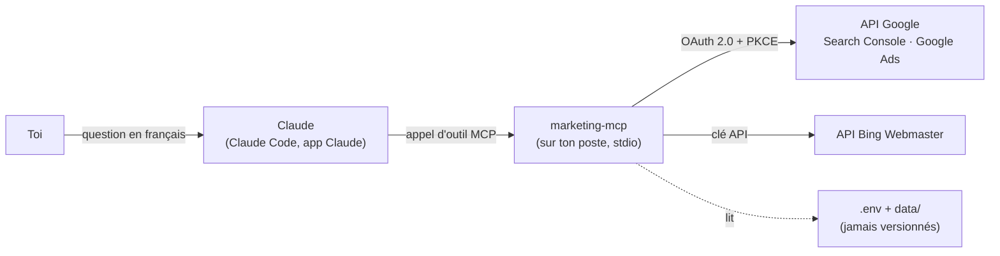

# marketing-mcp

**Pose tes questions marketing à Claude, il va chercher les chiffres lui-même.**

`marketing-mcp` est un serveur [MCP](https://modelcontextprotocol.io) (Model Context Protocol) qui
donne à Claude un accès **en lecture seule** à tes données SEO et SEA :
Google Search Console, Google Ads et Bing Webmaster Tools.

Au lieu d'exporter des CSV, de croiser des onglets et de recopier des chiffres dans un rapport, tu
demandes :

> « Compare les performances des campagnes Search sur Tours, de janvier à septembre 2026,
> avec l'année dernière, et sors-moi les mots-clés qui génèrent des visites en magasin. »

Claude choisit les bons outils, interroge les API, calcule les écarts et répond avec un tableau.

Le serveur tourne **sur ton poste** : tes jetons restent dans des fichiers locaux, et les données
ne passent par aucun service tiers en dehors des API Google et Microsoft elles-mêmes.

---

## Ce qu'il sait faire

| Source | Outils | Ce que tu peux demander |
|---|---|---|
| **Google Search Console** | `gsc_list_sites`, `gsc_search_analytics` | Clics, impressions, CTR et position par requête, page, pays, appareil ou date, avec filtres |
| **Google Ads** | `gads_list_customers`, `gads_performance`, `gads_search` | Performances par compte, campagne, groupe d'annonces, mot-clé ou terme de recherche ; toute requête GAQL `SELECT` (zones géographiques, conversions, visites en magasin…) |
| **Bing Webmaster Tools** | `bing_list_sites`, `bing_traffic`, `bing_top`, `bing_crawl_stats` | Trafic Bing par jour, top requêtes et pages, exploration et indexation |
| — | `marketing_list_sources` | Quelles sources sont branchées, et comment brancher les autres |

GA4 et Meta Ads sont prévus (voir [Feuille de route](#feuille-de-route)).

Détail de chaque outil, paramètres et sorties : **[docs/outils.md](docs/outils.md)**.

### Exemples de questions

- « Quelles sont mes 20 requêtes Search Console qui ont le plus progressé ce mois-ci sur `blog.exemple.fr` ? »
- « Sur Google Ads, quel est le coût par visite en magasin des campagnes Search ciblant Tours, et quels mots-clés les portent ? »
- « Compare le trafic Bing et Google de `www.exemple.fr` sur les 3 derniers mois. »
- « Bing a-t-il des erreurs d'exploration ou des pages bloquées par robots.txt sur mon site ? »

---

## Comment ça marche



- **Transport stdio** : Claude lance le serveur comme un programme local ; rien n'est exposé sur le réseau.
- **OAuth « application de bureau » avec PKCE** : une commande ouvre le navigateur une seule fois,
  le refresh token est enregistré dans `data/google-token.json`.
- **Lecture seule garantie par le code** : le serveur n'appelle que des méthodes de lecture
  (`searchAnalytics.query`, `googleAds:search`, méthodes `Get*` de Bing) et `gads_search` refuse
  toute requête qui n'est pas un `SELECT`.
- **Listes blanches** : tu choisis dans `.env` les sites et comptes interrogeables ; les autres sont
  refusés avant tout appel réseau.
- **Sorties structurées** : chaque outil déclare un schéma d'entrée et de sortie (zod), Claude reçoit
  du JSON typé.

---

## Démarrage rapide

### Prérequis

- [Node.js](https://nodejs.org) 22 ou plus
- [Claude Code](https://claude.com/claude-code) (terminal, application de bureau ou extension d'IDE)
- Pour Google : un projet Google Cloud avec un client OAuth de type « Application de bureau »
- Pour Bing : un compte Bing Webmaster Tools

### Installation

```bash
git clone https://github.com/abdouldoro-diallo/marketing-mcp.git
cd marketing-mcp
npm install
cp .env.example .env
```

Sous Windows PowerShell, remplace `npm` par `npm.cmd` (la stratégie d'exécution bloque `npm.ps1`)
et `cp` par `copy`.

### Configuration

1. Remplis `.env` : voir **[docs/installation.md](docs/installation.md)**, qui détaille pas à pas la
   création du projet Google Cloud, de l'écran de consentement, du client OAuth et de la clé Bing.
2. Autorise ton compte Google :
   ```bash
   npm run auth:google
   ```
3. Ouvre Claude Code **dans le dossier du projet** : `.mcp.json` y déclare le serveur. Accepte de
   faire confiance au serveur du projet quand Claude Code le demande.
4. Demande à Claude : « Quelles sources marketing sont disponibles ? »

Pour avoir le serveur dans toutes tes sessions, quel que soit le dossier :

```bash
claude mcp add marketing-mcp --scope user -- node /chemin/vers/marketing-mcp/node_modules/tsx/dist/cli.mjs /chemin/vers/marketing-mcp/src/index.ts
```

---

## Configuration (`.env`)

| Variable | Obligatoire | Rôle |
|---|---|---|
| `GOOGLE_CLIENT_ID` | pour Google | Client OAuth Google (application de bureau) |
| `GOOGLE_CLIENT_SECRET` | pour Google | Secret de ce client |
| `GSC_SITE_URLS` | non | Propriétés Search Console interrogeables, séparées par des virgules, écrites exactement comme dans Search Console (`https://www.exemple.fr/`, `sc-domain:exemple.fr`). Vide = toutes. |
| `GOOGLE_ADS_LOGIN_CUSTOMER_ID` | non | Compte administrateur (MCC) par lequel lire les comptes clients |
| `GOOGLE_ADS_CUSTOMER_IDS` | non | Comptes Google Ads interrogeables (10 chiffres, tirets acceptés). Vide = tous. |
| `GOOGLE_ADS_API_VERSION` | non | Version de l'API Google Ads, défaut `v26` |
| `GOOGLE_ADS_DEVELOPER_TOKEN` | non | Ignoré par Google depuis le 9 septembre 2026 ; envoyé seulement s'il est renseigné |
| `BING_API_KEY` | pour Bing | Clé API Bing Webmaster Tools |
| `BING_SITE_URLS` | non | Sites Bing interrogeables, séparés par des virgules, écrits comme dans Bing Webmaster. Vide = tous. |

Chaque source est indépendante : sans clé Bing, les outils Google fonctionnent, et inversement.

---

## Sécurité et confidentialité

- **Aucun secret dans le dépôt.** `.env` (identifiants) et `data/` (refresh token) sont dans
  `.gitignore`. Le fichier `.env.example` ne contient que des noms de variables.
- **Lecture seule.** Aucun outil ne crée, ne modifie ni ne supprime quoi que ce soit dans tes comptes.
  Le scope `adwords` (Google Ads) n'a pas de variante lecture seule chez Google : c'est le serveur
  qui garantit la lecture seule, en n'exposant que des appels de lecture.
- **Clés jamais affichées.** La clé Bing voyage dans l'URL (c'est le fonctionnement de l'API Bing),
  mais les messages d'erreur ne la contiennent jamais ; un test le vérifie.
- **Mode « Test » Google.** Tant que l'application OAuth est en mode Test, Google invalide le
  refresh token au bout de 7 jours : relance `npm run auth:google`.

---

## Développement

```bash
npm run typecheck    # vérification TypeScript (strict)
npm test             # tests vitest : un faux fetch simule Google et Bing, aucun appel réseau
npm start            # lance le serveur à la main (stdio)
npm run auth:google  # autorise le compte Google
```

```
src/
  index.ts         point d'entrée stdio : lit .env, assemble les clients, démarre le serveur
  server.ts        déclaration des outils MCP (schémas d'entrée/sortie, listes blanches)
  sources.ts       catalogue des sources et de leur état
  config.ts        lecture de .env, chemins du projet, normalisation des IDs Google Ads
  google-auth.ts   OAuth Google : URL d'autorisation (PKCE), refresh token, jeton d'accès
  auth-google.ts   commande « auth:google » (serveur local de rappel sur 127.0.0.1)
  gsc.ts           client Search Console
  google-ads.ts    client Google Ads (GAQL, pagination, erreurs) et rapport de performances
  bing.ts          client Bing Webmaster (clé API, dates WCF, cumul hebdomadaire)
tests/             vitest, un fichier par source + démarrage stdio réel depuis .mcp.json
docs/              guide d'installation et référence des outils
```

Pour ajouter une source : un client dans `src/<source>.ts` (avec `fetch` injectable pour les
tests), sa configuration dans `config.ts`, ses outils dans `server.ts`, son état dans `sources.ts`,
puis un fichier de tests avec un faux `fetch`.

---

## Dépannage

| Message | Cause | Solution |
|---|---|---|
| « Compte Google non autorisé » | Pas de `data/google-token.json` | `npm run auth:google` |
| « Autorisation Google expirée ou révoquée » | Application OAuth en mode Test (7 jours) ou accès retiré | `npm run auth:google` |
| « L'autorisation Google actuelle n'inclut pas Google Ads » | Autorisation faite avant le connecteur Ads, ou accès décoché | `npm run auth:google` en cochant Google Ads |
| « n'a que l'accès Test » | Projet Cloud sans accès Explorer à l'API Google Ads | Demander l'accès Explorer (voir [docs/installation.md](docs/installation.md)) |
| « Active Google Ads API » | API non activée dans le projet Cloud | L'activer dans la bibliothèque d'API |
| `USER_PERMISSION_DENIED` | Compte géré via un MCC | Passer `loginCustomerId` ou renseigner `GOOGLE_ADS_LOGIN_CUSTOMER_ID` |
| « Propriété / Compte / Site non autorisé » | Absent de la liste blanche | Ajouter à `GSC_SITE_URLS`, `GOOGLE_ADS_CUSTOMER_IDS` ou `BING_SITE_URLS` |
| « Bing Webmaster n'est pas configuré » | Pas de `BING_API_KEY` | Générer la clé (voir [docs/installation.md](docs/installation.md)) |
| Bing `HTTP 401` / `403` | Clé invalide ou révoquée | Régénérer la clé dans Bing Webmaster |
| Les nouveaux outils n'apparaissent pas | Serveur chargé avant la modification | Ouvrir une nouvelle session Claude |

---

## Feuille de route

| Source | État |
|---|---|
| Google Search Console | ✅ validé avec un vrai compte |
| Google Ads (API v26) | ✅ validé avec un vrai compte (accès Explorer) |
| Bing Webmaster Tools | ✅ validé avec une vraie clé API |
| Google Analytics 4 | ⏳ prévu |
| Meta Ads | ⏳ prévu |
| Google Business Profile | ⏳ en attente de l'accès API Google |

---

## Licence

[MIT](LICENSE) © 2026 Abdoul Diallo
