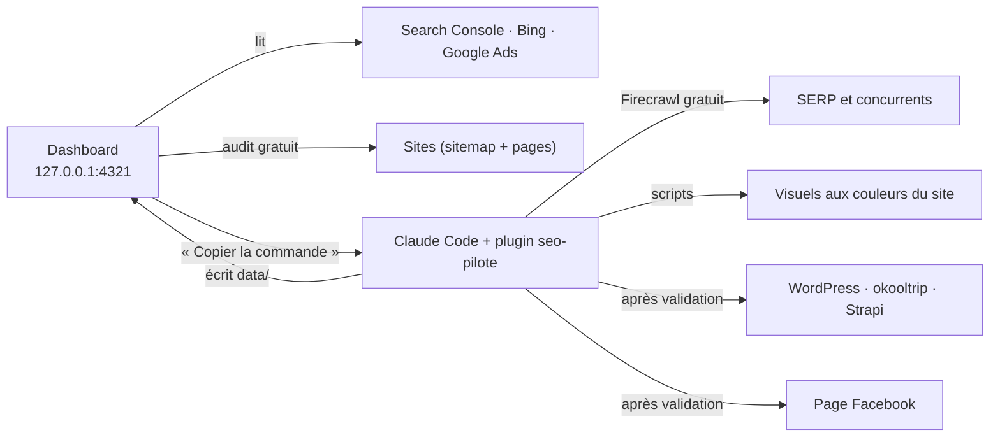

# Dashboard « Pilote SEO » et plugin `seo-pilote`

Tout est gratuit : API officielles (Search Console, Bing Webmaster, Google Ads, Graph Facebook, IndexNow,
REST WordPress), Firecrawl en offre gratuite, et Claude pour l'analyse et la rédaction.



## 1. Installation (une fois)

Dans PowerShell, dossier `C:\Users\adiallo3\marketing-mcp` :

```powershell
npm.cmd install          # ajoute le moteur de rendu des visuels (@resvg/resvg-js)
npm.cmd run dashboard    # puis ouvrir http://127.0.0.1:4321
```

Le dashboard réutilise `.env` et `data/google-token.json` du serveur MCP : rien de plus à configurer pour
Search Console, Bing et Google Ads. Si Google répond « autorisation expirée », relancer `npm.cmd run auth:google`.

## 2. Le plugin de skills (Claude Code)

Dans Claude Code, ouvert dans le dossier du projet :

```
/plugin marketplace add C:\Users\adiallo3\marketing-mcp
/plugin install seo-pilote@marketing-mcp
```

Les boutons « Copier la commande » du dashboard produisent des commandes comme
`/seo-pilote:seo-opportunites meta https://blog.indigoneo.fr/parking-gare-de-lyon/ "parking gare de lyon"` :
il suffit de les coller dans Claude Code.

| Skill | Rôle |
|---|---|
| `seo-pilotage` | Point d'entrée, règles communes, outil de publication par site |
| `seo-opportunites` | Meta (CTR faible), contenu (page 2), cannibalisation, déclin |
| `seo-concurrents` | Comparaison avec le top 3 via Firecrawl → onglet Concurrents |
| `seo-technique` | Correction des problèmes de l'audit |
| `seo-maillage` | Plan et pose des liens internes |
| `seo-article-complet` | Brief → rédaction → visuel → publication → Facebook → Discover |

## 3. Les onglets

| Onglet | Source | Ce qu'on y trouve |
|---|---|---|
| Performances | Search Console + Bing | Clics, impressions, CTR, position vs période précédente, top pages et requêtes |
| Opportunités | Search Console | CTR faible, page 2, cannibalisation, déclin, triés par clics à gagner |
| Discover | Search Console (type discover) | Clics et pages Discover, rappel des conditions d'éligibilité |
| Technique | Bing (exploration) + audit gratuit | Erreurs HTTP, noindex, titles, meta, H1, canonical, contenu mince, conditions Discover |
| Concurrents | Firecrawl via Claude | Écarts avec le top 3 (fichier `data/concurrents/<site>.json`) |
| Contenu & social | Suivi des articles | Avancement brief → Facebook, visuels, charte graphique |
| SEO × SEA | Google Ads + Search Console | Termes payés déjà top 3 en SEO, termes qui convertissent sans page SEO |

Les réponses des API sont gardées 15 minutes en mémoire ; « Actualiser » force une nouvelle lecture.

## 4. Charte graphique et visuels

```powershell
npm.cmd run charte -- https://blog.indigoneo.fr/
npm.cmd run visuel -- --site https://blog.indigoneo.fr/ --titre "Où se garer près de la gare de Lyon" --surtitre "Guide parking"
```

`data/charte/blog.indigoneo.fr.json` se corrige à la main (couleurs, police, logo). Si la police de la marque
n'est pas installée sur le poste, l'indiquer avec `--police-fichier C:\chemin\police-Bold.ttf`.
Avec `--photo C:\chemin\photo.jpg`, la photo sert de fond (recommandé pour Discover).

## 5. Facebook (API Graph, gratuite)

1. Sur https://developers.facebook.com, créer une application de type « Entreprise ».
2. Dans l'Explorateur de l'API Graph, générer un jeton utilisateur avec les permissions
   `pages_manage_posts`, `pages_read_engagement` et `pages_show_list`, puis l'échanger contre un jeton longue durée.
3. Appeler `GET /me/accounts` : la ligne de la Page donne son `id` et son `access_token` (jeton de Page, sans expiration
   s'il vient d'un jeton utilisateur longue durée).
4. Dans `.env` : `FB_PAGE_ID=…` et `FB_PAGE_TOKEN=…`.

Le script n'envoie rien sans `--publier` : il affiche d'abord l'aperçu.

## 6. IndexNow (Bing)

```powershell
npm.cmd run indexnow -- --cle
```

Déposer le fichier `<clé>.txt` à la racine de chaque site, puis ajouter `INDEXNOW_KEY` dans `.env`.
Google n'utilise pas IndexNow : pour Google, le sitemap et les liens internes suffisent.

## 7. WordPress (image à la une)

Créer un mot de passe d'application (WordPress → Comptes → Profil), puis `data/wordpress.json` :

```json
{
  "blog.indigoneo.fr": { "url": "https://blog.indigoneo.fr", "utilisateur": "abdoul", "motDePasseApplication": "xxxx xxxx xxxx xxxx xxxx xxxx" }
}
```

## 8. Google Discover : ce qui est possible

Aucune API ne permet de soumettre une page à Discover. On agit sur ce que Google regarde : image à la une
d'au moins 1200 px avec `max-image-preview:large`, titre fidèle (pas de clickbait), données structurées Article
avec auteur et date, sujets frais ou à fort intérêt, expertise visible. `npm.cmd run discover -- <url>` vérifie
les points techniques, l'onglet Discover mesure le résultat.

## 9. Cockpit SEO data (v2)

L'interface suit le wireframe « SEO Data Cockpit » : barre latérale (sites et vues), sélecteur **Google / Bing**,
période, termes de marque et compte Google Ads en haut de page.

| Vue | Sources | Ce qu'on y trouve |
|---|---|---|
| Vue d'ensemble | GSC ou Bing, crawl, PageSpeed | KPI avec tendance, Bing à côté de Google, « Ce qui a changé » (anomalies > 2σ, baisses), treemap des clusters, backlog « Quoi faire maintenant » |
| KR Visibilité | GSC + Bing | KR « Organic Search Visibility » sur un panier fixe de requêtes hors marque, par mois, par typologie, baseline et cible |
| Mots-clés | GSC ou Bing | Top 3 / 4-10 / 11-20 / 21-50 / 50+ et évolution, entrées et sorties du Top 3 et du Top 10, nouvelles et perdues, marque / hors marque, intentions, longue traîne, appareils, pays, clusters thématiques et par page, export CSV |
| Pages & backlog | GSC + crawl + PageSpeed | Chaque page croisée (clics, évolution, HTTP, profondeur, liens entrants, mots, CWV), drapeaux (zombie, orpheline, profonde, contenu mince, déclin), répertoires, backlog priorisé |
| Alertes | GSC ou Bing, crawl, PageSpeed | Baisse globale (total, marque, hors marque), rupture semaine sur semaine, anomalies, pages en baisse, sorties du Top 3 / 10, reculs, requêtes perdues, pages en erreur ou noindex avec trafic, CWV mauvais ; seuils réglables |
| Crawl | Firecrawl ou crawler interne | Codes HTTP (200, 301, 404, 5xx), profondeur, liens internes entrants et sortants, liens cassés, liens vers des redirections, orphelines, pages hors sitemap, title, meta, Hn, schémas, volume de mots |
| Core Web Vitals | PageSpeed Insights | LCP, INP, CLS terrain (CrUX, page et origine) et labo, score Lighthouse, optimisations les plus rentables |
| Benchmark | Firecrawl | Ta page face au top 3 : mots, H2/H3, FAQ, tableaux, schémas, images, liens, requête dans le title, couverture sémantique et termes manquants |

### Score des actions

`score = gain × confiance ÷ effort`, où le gain est en clics par période (impressions × (CTR cible − CTR actuel)
pour les actions de CTR, de contenu et de maillage ; clics perdus pour le déclin et les erreurs). Confiance de 0,3 à 0,8
selon le type d'action, effort de 1 (faible) à 3 (fort). Le volet de détail affiche le calcul et les sources.

### KR Organic Search Visibility

`Visibility Share = Σ (poids × score de position) ÷ Σ (poids × 100)` sur un panier figé de requêtes stratégiques
hors marque (`data/visibilite/<site>.json`). Barème : 1 → 100, 2 → 85, 3 → 70, 4-5 → 50, 6-10 → 25, 11-20 → 10,
au-delà ou absent → 0. Poids = 2,5 × log10(impressions) borné de 1 à 10. Le panier est proposé à partir des 3 derniers
mois complets puis ne bouge plus ; on peut l'éditer à la main (requêtes, typologies, poids) : l'historique est recalculé.
La position est la position moyenne mensuelle de Search Console (Bing pour l'indicateur Bing). Les mois complets
Google sont mis en cache dans `data/visibilite/<site>-google-mois.json`.

Limites : la visibilité dans les fonctionnalités génératives de Google (AI Overviews, AI Mode) n'est pas encore exposée
par l'API Search Console, et la visibilité locale (Local Pack) se mesure par grille géographique : ces deux indicateurs
complémentaires sont à alimenter séparément (Yext Scout, outil de suivi local).

### Crawl et PageSpeed

Lancés depuis le dashboard en tâche de fond (barre de progression). Résultats dans `data/crawls/` et `data/pagespeed/`.
Le crawler interne respecte `robots.txt`, part de l'accueil, suit les liens internes (hors nofollow), enregistre
les redirections sans les suivre automatiquement, puis complète avec les URL du sitemap jamais atteintes (orphelines).

### Visibilité locale (fiches Google via Yext)

- **Yext** (MCP Yext, lu par Claude avec le skill `seo-local`, écrit dans `data/yext/<site>.json`) : vues des fiches,
  itinéraires, clics vers le site et appels par mois ; fiches Google en ligne ou en anomalie ; fiches sans page de destination.
- **Rapprochement par URL** : toute URL avec un paramètre `utm_` (yextgmb, yext, gmb…) vient d'une fiche Google. Search Console isole donc,
  page par page, les clics et la position venus des fiches, à comparer au trafic organique de la même URL (« part locale »).
- **Visibilité locale** : le barème du KR appliqué aux positions des liens de fiche sur le panier de requêtes.
- **Pages sans trafic de fiche** : pages parking à trafic organique qui ne reçoivent aucun clic de fiche (fiche absente,
  fermée ou mal reliée).

Pour rafraîchir : dans Claude Code, « mets à jour les données Yext du dashboard » (`/seo-pilote:seo-local <site>`).

### Maillage interne

À partir du crawl : liens entrants et sortants de chaque URL, profondeur, PageRank interne (0-100, échelle log) croisé
avec les clics et impressions. « À renforcer » = au moins 500 impressions et PageRank < 40 ; « popularité gaspillée » =
PageRank ≥ 60 sans clic. Un clic sur une URL liste les pages qui pointent vers elle et ses liens sortants.

Chaque vue commence par un encadré « À quoi sert cette vue ? » (ce qu'on y voit, comment lire, que faire), repliable.

### Visibilité locale par pays (API Yext)

Avec `YEXT_API_KEY` (clé en lecture seule) dans `.env`, la vue « Visibilité locale » lit directement l'API Analytics
de Yext, par dossier : tous les pays, France, France · parkings (France moins les bornes), France · bornes de recharge
(dossiers `EV Stations` et `OuestEV`), Belgique, Belgique · bornes, Espagne, Canada, Suisse, Luxembourg, Andorre, Brésil.

| Donnée | Métrique Yext |
|---|---|
| Vues Google Search / Maps | `LISTINGS_IMPRESSIONS` par `APP` |
| Actions par éditeur et par type (itinéraires, clics site, appels) | `TOTAL_LISTINGS_ACTIONS` par `SITES` et `ACTION` (715 = Google, 950 = Apple) |
| Vues Apple Plans | `APPLE_PLACE_CARD_VIEWS` |
| Vues Bing | `BING_SEARCHES` (hebdomadaire, regroupé par mois) |

Fenêtre : les 13 derniers mois complets, comparés au même mois N-1. Les réponses sont gardées 12 h dans
`data/yext/cache/` ; « Actualiser » relit l'API. Les dossiers sont filtrés avec `folderIds` (identifiants externes,
sous-dossiers inclus).
